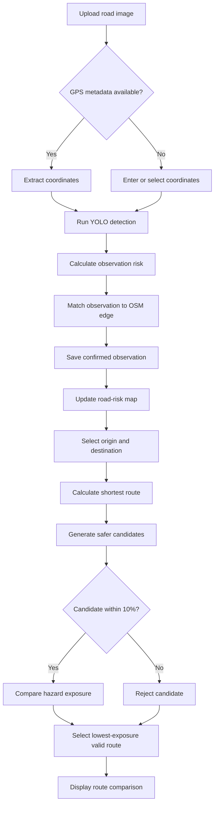

# Road Damage Detection and Safer Routing Application

## Overview

This repository contains a Streamlit-based decision-support prototype for detecting road-surface damage, geolocating the detected hazards, building a persistent road-risk map, and calculating a safer driving route.

The application connects the complete project pipeline:

> Road image -> GPS location -> damage detection -> risk score -> OpenStreetMap road segment -> risk map -> safer route -> measurable route comparison

The system uses a trained YOLO object-detection model to identify four types of road damage. Each geolocated observation is converted into a rule-based risk score and matched to the nearest OpenStreetMap road segment. When a user requests directions, the application compares the normal shortest route with a risk-aware alternative. The safer route should reduce road-damage exposure while remaining no more than 10% longer than the shortest route.

The application is intended as a graduation-project prototype. It demonstrates the complete inference and routing workflow; model training remains outside the Streamlit interface in separate notebooks or scripts.

---

## Project objectives

The application must:

1. Accept one or more road images.
2. Extract GPS coordinates from EXIF metadata or accept coordinates manually.
3. Detect and classify road damage with a trained YOLO model.
4. Calculate a reproducible risk score for each observation.
5. Store confirmed images, detections, coordinates, and risk results.
6. Associate each observation with an OpenStreetMap road segment.
7. Visualize accumulated hazards as markers, road-segment risks, and a heatmap.
8. Calculate the distance-based shortest route between two locations.
9. Calculate a risk-aware alternative route.
10. Enforce a maximum 10% distance increase for the safer route.
11. Compare the routes using distance and hazard-exposure metrics.
12. Export experimental results for use in the graduation report.

---

## Supported road-damage classes

The first application version supports only the four selected RDD2022 classes:

| Model ID | Code | Damage type |
| ---: | --- | --- |
| 0 | D00 | Longitudinal crack |
| 1 | D10 | Transverse crack |
| 2 | D20 | Alligator crack |
| 3 | D40 | Pothole |

Class `4` and unknown damage categories are excluded from the first version.

---

## User roles and intended use

The main user can:

- Upload new road observations periodically.
- Verify or provide the observation location.
- Run road-damage detection.
- Review and save valid detections.
- Inspect accumulated road risks.
- Request and compare shortest and safer routes.
- Export detection, risk, and route results.

An optional developer or administrator section can provide data-maintenance functionality, such as correcting coordinates, deleting invalid observations, re-running inference, and rebuilding road-segment risks.

---

## Application pages

The Streamlit application should contain five primary pages:

1. **Dashboard**
2. **Upload & Detect**
3. **Damage Map**
4. **Safer Route Planner**
5. **Results & Evaluation**

An optional sixth page can provide **Settings & Data Management**.

The sidebar should contain:

- Page navigation
- Loaded model name and version
- Model status
- Number of stored images
- Number of stored detections
- Configured confidence threshold
- Button to clear active filters

---

## 1. Dashboard

The Dashboard provides a concise overview of the current application state.

### Required summary cards

- Total processed and saved images
- Total detected road damages
- Number of affected road locations or road segments
- Average road-risk score
- Number of high-risk locations

### Required summaries

- Number of detections per damage class
- Number of low-, medium-, and high-risk observations
- Recently processed images
- Small overview map containing all saved observations

### Recommended visualizations

- Bar chart of detections by damage class
- Bar or pie chart of observations by risk category
- Interactive overview map
- Recent-uploads table

### Empty state

When the database contains no observations, the page should explain that the user must upload geolocated road images before the road-risk map and route planner can use detected hazards.

---

## 2. Upload & Detect

This page handles image input, GPS information, model inference, result review, and saving.

### 2.1 Image upload

The user should be able to upload one or multiple images in the following formats:

- `.jpg`
- `.jpeg`
- `.png`

Batch upload is preferred because road observations may be collected and added periodically. Every uploaded image should receive a unique identifier, and a file hash should be calculated to prevent accidental duplicate processing.

### 2.2 GPS extraction

The application must first attempt to read latitude and longitude from the image's EXIF metadata.

If GPS data is available, the application should:

- Extract latitude and longitude.
- Display the coordinates.
- Mark the location on a preview map.
- Label the coordinate source as `EXIF`.
- Allow the user to verify the location before saving.

If GPS data is unavailable, which is common for screenshots, the application should request:

- Latitude
- Longitude

Optionally, the user can select the location by clicking on a map. The source should then be stored as `manual` or `map selection`.

An observation must not be saved without valid coordinates.

### 2.3 Input validation

Before inference or saving, the application should verify that:

- The file format is supported.
- The image can be opened.
- Latitude is between -90 and 90.
- Longitude is between -180 and 180.
- The image has not already been saved.
- A trained model is available.

Clear warnings should be shown for invalid files, missing coordinates, duplicate images, and unavailable models. Python tracebacks must not be exposed to normal users.

### 2.4 Model inference

When the user selects **Analyse images**, the application should:

1. Load the selected trained YOLO model.
2. Run object detection on every valid image.
3. Retain detections above the configured confidence threshold.
4. Record the class, confidence score, and bounding-box coordinates.
5. Calculate the relative area of every bounding box.
6. Create an annotated copy of the image.
7. Calculate detection-level and image-level risk scores.
8. Display the results for review.

The model should be cached so that it is loaded only once per application process.

### 2.5 Confidence threshold

The user may adjust the minimum detection confidence, for example between `0.10` and `0.90`. A practical default is `0.25`.

Detections below the selected threshold should not:

- Appear as accepted detections.
- Contribute to the risk score.
- Be stored in the permanent detections table.
- Affect route calculations.

The threshold used for each processed image must be saved to ensure experimental reproducibility.

### 2.6 Detection results

For every image, the page should display:

- Original image
- Annotated image
- Latitude and longitude
- Coordinate source
- Number of accepted detections
- Detected classes
- Confidence of every detection
- Relative bounding-box area
- Detection risk contribution
- Overall image-risk score
- Assigned risk category
- Inference time

The annotated image should show the damage class and confidence score next to each bounding box.

Example result table:

| Damage | Confidence | Relative box area | Risk contribution |
| --- | ---: | ---: | ---: |
| D40 Pothole | 0.84 | 7.2% | 0.78 |
| D00 Longitudinal crack | 0.69 | 12.4% | 0.35 |

If no damage is detected, the application should show a valid result rather than an error. The user may decide whether no-damage observations should be stored.

### 2.7 Confirming and saving observations

Inference results should remain temporary until the user confirms them.

The page should provide:

- **Save observation** for one image
- **Save all valid observations** for a batch

Only saved observations may affect:

- Dashboard statistics
- Damage-map markers
- Road-segment risk
- Heatmaps
- Safer-route calculations
- Evaluation exports

---

## 3. Risk-scoring system

The rule-based scoring system connects object detection to risk-aware routing. The exact parameters must be defined, justified, and kept consistent during final evaluation.

### 3.1 Detection-level risk

A practical structure is:

```text
detection_risk = class_weight * confidence * size_factor
```

Where:

- `class_weight` represents the expected severity of the detected damage type.
- `confidence` is the model confidence.
- `size_factor` is based on the bounding-box area relative to the full image.

The class ordering should reflect the project's safety assumptions:

| Damage class | Expected relative severity |
| --- | --- |
| D00 Longitudinal crack | Low |
| D10 Transverse crack | Medium |
| D20 Alligator crack | High |
| D40 Pothole | High |

The final numerical weights must be stored in configuration rather than scattered throughout the code.

### 3.2 Image-level risk

If an image contains multiple detections, their risk contributions must be combined into one normalized observation score:

```text
0 <= observation_risk <= 1
```

The aggregation formula may consider:

- Maximum individual risk
- Combined risk from multiple detections
- Number of repeated damages
- Relative area covered by damage

One documented formula must be used throughout the experiment.

### 3.3 Risk categories

The normalized score should be converted to:

- **Low risk** - green
- **Medium risk** - orange
- **High risk** - red

The application must display both the numerical score and its category. The thresholds should be stored in configuration and should match those used when evaluating H2.

### 3.4 Multiple observations on the same road

Several images may be matched to the same road segment. The application should aggregate them and store:

- Number of observations
- Mean risk
- Maximum risk
- Most recent observation date
- Final aggregated edge risk

For safety-focused routing, maximum risk or a documented weighted combination of maximum and mean risk is preferable. A severe pothole should not be hidden by several low-risk observations.

---

## 4. Damage Map

The Damage Map visualizes all confirmed observations and their effect on the road network.

### 4.1 Observation markers

Each observation should be shown at its stored GPS location.

Suggested marker colors:

- Green: low risk
- Orange: medium risk
- Red: high risk
- Grey: no detected damage, if such observations are stored

Selecting a marker should display:

- Image preview
- Processing date and time
- GPS coordinates
- Coordinate source
- Detected damage types
- Number of detections
- Highest confidence score
- Numerical risk score
- Risk category
- Associated road segment

### 4.2 Filters

The user should be able to filter map observations by:

- Damage class
- Risk category
- Minimum confidence
- Upload date or batch
- Whether no-damage images are shown

Map filters should affect only visualization unless the interface explicitly allows a filter to change the routing dataset.

### 4.3 Road-segment layer

The application should provide a layer that colors matched road segments according to their aggregated risk. This shows how isolated observations become usable routing information.

### 4.4 Heatmap layer

The user should be able to switch between or combine:

- Observation markers
- Risk-colored road segments
- Weighted risk heatmap

The heatmap should use GPS coordinates and normalized risk scores. It will also support evaluation of H4 against manual pilot-area labels.

---

## 5. Matching observations to OpenStreetMap roads

Every confirmed geolocated observation must be associated with the nearest valid driving edge in the OpenStreetMap network.

The matching process should:

1. Load or retrieve the driving graph for the pilot area.
2. Find the nearest valid road edge to the GPS point.
3. Record the edge as `(u, v, key)`.
4. Calculate the point-to-edge matching distance.
5. Save the association.
6. Recalculate the aggregated risk of the affected edge.

The application should store:

- Edge identifiers `u`, `v`, and `key`
- Road name, when available
- Edge length
- Distance from the observation to the matched edge
- Aggregated edge risk
- Observation count
- Damage classes recorded on the edge

If an observation is farther than the configured maximum matching distance from the nearest road, it should be flagged for manual review rather than silently assigned to a potentially incorrect street.

---

## 6. Safer Route Planner

The Safer Route Planner is the main decision-support component of the prototype.

### 6.1 Origin and destination

The user should be able to choose route endpoints using one or more of the following methods:

- Enter latitude and longitude.
- Click origin and destination on a map.
- Enter an address, if geocoding is implemented.
- Select a predefined experimental route.

Predefined test routes are recommended because they allow repeated and comparable experiments.

The page should clearly show:

- Selected origin
- Selected destination
- Travel mode, normally driving
- Pilot or graph area used for calculation

### 6.2 Road graph

OSMnx should load or retrieve a driving network. The NetworkX graph should contain:

- Nodes representing road-network points or intersections
- Edges representing road segments
- Edge length
- Aggregated risk
- Risk-aware routing cost

The graph should be cached locally or with Streamlit caching to avoid repeated downloads.

### 6.3 Shortest route

The baseline route minimizes total road length:

```text
shortest_route = argmin(sum(edge_length))
```

This provides the distance-based route against which the safer alternative is compared.

### 6.4 Risk-aware edge cost

A practical combined cost is:

```text
risk_aware_cost = edge_length * (1 + lambda * edge_risk)
```

Where:

- `edge_length` is the length of the road segment.
- `edge_risk` is its normalized aggregated risk.
- `lambda` controls how strongly the algorithm avoids damaged roads.

The final formula and parameter values must be documented and retained with experimental results.

### 6.5 Candidate routes

The system should generate several valid candidate routes using an approach such as:

- Multiple risk-weight values
- K-shortest paths
- Alternative simple paths within a constrained search space

Each candidate should be evaluated using:

- Total distance
- Percentage distance increase
- Total hazard exposure
- Normalized hazard exposure
- Number of risky road segments
- Number of high-risk segments
- Maximum segment risk

### 6.6 Maximum 10% distance constraint

The safer route must satisfy:

```text
distance_increase_percent =
    ((safe_distance - shortest_distance) / shortest_distance) * 100

distance_increase_percent <= 10
```

The correct route-selection process is:

1. Calculate the shortest route.
2. Generate risk-aware candidate routes.
3. Reject candidates that are more than 10% longer.
4. Compare hazard exposure among the remaining candidates.
5. Select the valid route with the lowest exposure.
6. Use the shortest route if no safer valid alternative exists.

The distance constraint must therefore be part of route selection, not only a warning shown after a route has been selected.

### 6.7 Route map

The results map should show:

- Origin marker
- Destination marker
- Shortest route in blue
- Safer route in green
- Risky roads in orange or red
- Damage markers located along both routes

If the two routes overlap, the visualization should make this clear through transparency, line style, or separate map-layer controls.

---

## 7. Route comparison

The application should present a direct comparison underneath the map.

| Metric | Shortest route | Safer route | Difference |
| --- | ---: | ---: | ---: |
| Distance | 2.40 km | 2.57 km | +7.1% |
| Hazard exposure | 0.68 | 0.31 | -54.4% |
| Risky segments | 5 | 2 | -3 |
| High-risk segments | 2 | 0 | -2 |
| Estimated travel time | Optional | Optional | Optional |

### Required metrics

- Shortest-route distance
- Safer-route distance
- Percentage distance increase
- Hazard exposure for both routes
- Percentage exposure reduction
- Number of observations encountered
- Number of low-, medium-, and high-risk segments
- Whether the 10% constraint was satisfied

### Route hazard exposure

Total route exposure can be calculated as:

```text
total_exposure = sum(edge_length * edge_risk for each edge in route)
```

Normalized exposure can be calculated as:

```text
normalized_exposure = total_exposure / total_route_length
```

Normalized exposure supports a fairer comparison between routes of different lengths. The project must designate one exposure definition as the primary optimization and reporting metric.

### Decision messages

The application should explain the result in plain language, for example:

> The safer route reduces estimated road-damage exposure by 54.4% while increasing the journey distance by 7.1%. It satisfies the maximum 10% distance-increase constraint.

If no valid alternative exists:

> No safer route satisfying the 10% distance limit was found. The shortest route is therefore recommended.

If an alternative does not provide a meaningful risk reduction:

> The alternative route is longer but does not provide a meaningful reduction in hazard exposure. The shortest route remains recommended.

---

## 8. Results & Evaluation

This page supports evaluation of the research hypotheses and provides exportable results.

### 8.1 Object-detection evaluation

The page may load finalized evaluation metrics produced by the model-evaluation scripts:

- Precision
- Recall
- F1-score
- mAP@50
- mAP@50-95
- Average inference time
- Number of evaluated images and objects

The Streamlit application does not need to train YOLO or Faster R-CNN. Model training and formal comparison should remain in notebooks or scripts. Streamlit should demonstrate the selected trained model and may display previously calculated metrics.

### 8.2 H1: Model comparison

The evaluation page may display the finalized YOLO and Faster R-CNN results used to test:

> YOLOv8 achieves mAP within 2% of Faster R-CNN while providing lower inference time.

### 8.3 H2: Risk-classification evaluation

The rule-based predicted category should be compared with manually assigned low-, medium-, and high-risk labels.

Required outputs:

- Accuracy
- Precision
- Recall
- F1-score
- Confusion matrix

Target:

```text
F1 >= 0.75
```

### 8.4 H3: Routing evaluation

For every predefined test route, store:

- Route ID
- Origin and destination
- Shortest-route distance
- Safer-route distance
- Distance increase
- Shortest-route exposure
- Safer-route exposure
- Exposure reduction
- Whether the 10% constraint was satisfied

Aggregate results should include:

- Median distance increase
- Mean and median hazard-exposure reduction
- Percentage of cases with a safer valid alternative
- Percentage satisfying the distance constraint

The hypothesis is supported when risk-aware routing reduces hazard exposure while the median distance increase remains at or below 10%.

### 8.5 H4: Heatmap validation

Generated segment or location risk should be compared with manual pilot-area labels.

Required outputs:

- Spearman correlation
- Number of evaluated locations or segments
- Ranked comparison or scatter plot

Target:

```text
Spearman rho >= 0.5
```

### 8.6 Exporting results

The user should be able to download:

- Detection records as CSV
- Observation-risk results as CSV
- Road-segment risks as CSV
- Route-comparison results as CSV
- Optional annotated images
- Optional interactive map as HTML

---

## 9. Persistent data storage

SQLite is sufficient for a local graduation-project prototype. All permanent data should be written only after user confirmation.

### 9.1 Images or observations table

Suggested fields:

| Field | Purpose |
| --- | --- |
| `image_id` | Unique image identifier |
| `filename` | Original filename |
| `file_hash` | Duplicate detection |
| `image_path` | Stored original image path |
| `annotated_image_path` | Stored annotated image path |
| `latitude` | Observation latitude |
| `longitude` | Observation longitude |
| `coordinate_source` | EXIF, manual, or map selection |
| `upload_timestamp` | Time processed or saved |
| `model_version` | Model used for inference |
| `confidence_threshold` | Threshold used during inference |
| `inference_time_ms` | Model inference duration |
| `image_risk_score` | Normalized observation risk |
| `risk_category` | Low, medium, or high |
| `matched_edge_u` | OSM edge start node |
| `matched_edge_v` | OSM edge end node |
| `matched_edge_key` | OSM multigraph edge key |
| `matching_distance` | Distance between GPS point and matched edge |

### 9.2 Detections table

Suggested fields:

| Field | Purpose |
| --- | --- |
| `detection_id` | Unique detection identifier |
| `image_id` | Parent image identifier |
| `class_id` | Numeric model class |
| `class_code` | D00, D10, D20, or D40 |
| `class_name` | Human-readable class name |
| `confidence` | Detection confidence |
| `bbox_x1`, `bbox_y1` | Top-left bounding-box coordinates |
| `bbox_x2`, `bbox_y2` | Bottom-right coordinates |
| `relative_bbox_area` | Box area relative to image area |
| `risk_contribution` | Detection-level risk |

### 9.3 Road segments table

Suggested fields:

| Field | Purpose |
| --- | --- |
| `edge_u`, `edge_v`, `edge_key` | Unique OSM edge identity |
| `road_name` | Road name when available |
| `edge_length` | Segment length in metres |
| `mean_risk` | Mean observation risk |
| `maximum_risk` | Maximum observation risk |
| `aggregated_risk` | Final routing risk |
| `risk_category` | Low, medium, or high |
| `observation_count` | Number of matched observations |
| `last_updated` | Most recent risk update |

### 9.4 Routes table

Suggested fields:

| Field | Purpose |
| --- | --- |
| `route_id` | Unique comparison identifier |
| `origin_latitude`, `origin_longitude` | Origin coordinates |
| `destination_latitude`, `destination_longitude` | Destination coordinates |
| `shortest_distance` | Baseline distance |
| `safe_distance` | Safer-route distance |
| `distance_increase_percentage` | Additional distance |
| `shortest_exposure` | Baseline hazard exposure |
| `safe_exposure` | Safer-route hazard exposure |
| `exposure_reduction_percentage` | Improvement in exposure |
| `constraint_satisfied` | Whether distance increase is at most 10% |
| `calculation_timestamp` | Calculation time |

---

## 10. Settings & Data Management

An optional developer-only page can allow the project owner to:

- View all stored observations.
- Correct inaccurate coordinates.
- Delete invalid observations.
- Re-run inference with a different model.
- Recalculate risk scores.
- Re-match observations to road edges.
- Rebuild all road-segment risks.
- Clear filters or test data.
- Export a database backup.

Destructive actions must require confirmation because deleting an observation changes the road-risk map and route calculations.

---

## 11. Application workflow



---

## 12. Error handling

The application must handle the following cases without crashing:

- Invalid or corrupted image
- Unsupported file type
- Missing or invalid coordinates
- Duplicate image upload
- No road damage detected
- Model file unavailable
- OpenStreetMap graph unavailable
- Observation outside the loaded graph area
- GPS point too far from any road
- Origin or destination cannot be matched to the network
- No path between the selected endpoints
- No safer route satisfying the 10% constraint
- Database read or write failure

Errors should be logged for the developer and translated into clear user-facing messages.

---

## 13. Performance and reproducibility requirements

The application should:

- Cache the loaded YOLO model.
- Cache the OpenStreetMap graph.
- Avoid downloading the same road network repeatedly.
- Display progress during batch processing.
- Store inference time per image.
- Preserve temporary unsaved results with Streamlit session state.
- Avoid recalculating all road risks after purely visual interactions.
- Save the model version, confidence threshold, scoring configuration, and routing parameters used for every experiment.
- Use fixed random seeds in any operation where randomness affects evaluation.

---

## 14. Suggested technical stack

- Python
- Streamlit
- Ultralytics YOLO
- PyTorch
- Pillow and/or OpenCV
- `piexif` or Pillow EXIF utilities
- OSMnx
- NetworkX
- GeoPandas and Shapely
- Folium with `streamlit-folium`
- SQLite
- Pandas
- Plotly, Matplotlib, or Seaborn for evaluation visualizations
- scikit-learn for classification metrics
- SciPy for Spearman correlation

---

## 15. Suggested repository structure

```text
road-damage-routing/
|-- app.py
|-- README.md
|-- requirements.txt
|-- .streamlit/
|   `-- config.toml
|-- pages/
|   |-- 1_Dashboard.py
|   |-- 2_Upload_and_Detect.py
|   |-- 3_Damage_Map.py
|   |-- 4_Safer_Route_Planner.py
|   |-- 5_Results_and_Evaluation.py
|   `-- 6_Data_Management.py
|-- src/
|   |-- config.py
|   |-- database.py
|   |-- exif_utils.py
|   |-- inference.py
|   |-- risk_scoring.py
|   |-- road_matching.py
|   |-- routing.py
|   |-- map_utils.py
|   `-- metrics.py
|-- models/
|   `-- best.pt
|-- data/
|   |-- app.db
|   |-- uploads/
|   |-- annotated/
|   |-- graph_cache/
|   `-- exports/
|-- config/
|   |-- risk_weights.yaml
|   `-- app_config.yaml
|-- tests/
|   |-- test_exif_utils.py
|   |-- test_risk_scoring.py
|   |-- test_road_matching.py
|   `-- test_routing.py
`-- notebooks/
    `-- model_evaluation.ipynb
```

---

## 16. Installation and execution

Create and activate a Python virtual environment, install the dependencies, and run Streamlit:

```bash
python -m venv .venv
```

Windows PowerShell:

```powershell
.venv\Scripts\Activate.ps1
pip install -r requirements.txt
streamlit run app.py
```

Windows Command Prompt:

```bat
.venv\Scripts\activate.bat
pip install -r requirements.txt
streamlit run app.py
```

Linux or macOS:

```bash
source .venv/bin/activate
pip install -r requirements.txt
streamlit run app.py
```

The trained model should be placed at the path configured for the application, for example:

```text
models/best.pt
```

---

## 17. Minimum viable product

The graduation-project MVP must include:

- Single and batch image upload
- EXIF GPS extraction
- Manual coordinates when EXIF is unavailable
- Detection of D00, D10, D20, and D40 damage
- Adjustable confidence threshold
- Annotated-image preview
- Detection class and confidence output
- Rule-based risk score
- Low-, medium-, and high-risk categories
- Persistent observation and detection storage
- Interactive map of saved hazards
- Matching observations to OSM road edges
- Risk aggregation per road segment
- Origin and destination selection
- Shortest-route calculation
- Risk-aware route calculation
- Candidate rejection above the 10% distance limit
- Map containing both route alternatives
- Distance and exposure comparison
- Exportable experiment results
- Clear validation and error messages

---

## 18. Optional future functionality

The following features are outside the required MVP:

- User accounts
- Live camera upload
- Video processing
- Automatic address geocoding
- Estimated travel time
- Municipal maintenance-priority ranking
- Repaired-road reporting and before/after tracking
- Mobile-optimized interface
- Cloud database and hosting
- Automatic scheduled map updates
- Multiple selectable inference models
- Model training from Streamlit

These features should be added only after the main detection, mapping, and routing pipeline works reliably.

---

## 19. Acceptance criteria

The application is considered functionally complete when the following end-to-end scenario works:

1. A user uploads two or more road images.
2. The application reads EXIF coordinates or accepts manual coordinates.
3. YOLO returns detections from the four supported classes.
4. The application displays annotated images and risk scores.
5. The user confirms and saves the observations.
6. The observations appear on the damage map.
7. Each valid point is matched to an OSM road edge.
8. The associated road risk is updated.
9. The user selects the same origin and destination for a controlled route test.
10. The application calculates the distance-based shortest route.
11. The application generates and evaluates safer candidates.
12. Candidates over 10% longer are rejected.
13. The lowest-exposure valid route is selected.
14. Both routes are displayed on the map.
15. Distance increase and hazard reduction are reported.
16. The result can be exported for evaluation.

---

## Final system definition

The final product is:

> An interactive road-safety decision-support prototype that processes geolocated road images, detects and classifies four types of road-surface damage using a trained YOLO model, converts detections into rule-based risk scores, stores and visualizes accumulated road hazards on an OpenStreetMap road network, and calculates a safer route that reduces hazard exposure while limiting the additional distance to a maximum of 10% for each selected alternative. Across the route-evaluation dataset, the project reports the median distance increase for testing H3.

The primary contribution is the integration of computer vision, geolocation, risk scoring, road-network mapping, and constrained risk-aware routing in one reproducible application.
